# FoodTasteApp

### 음식 취향을 기록하고, 다음 메뉴를 찾는 Unity 애플리케이션

**FoodTasteApp은 음식 평가와 식사 기록을 바탕으로 취향에 맞는 음식을 찾아보고, 친구와 의견을 나눌 수 있도록 만든 프로젝트입니다.** 음식 검색부터 별점·댓글, 추천, 랜덤 메뉴 선택까지 하나의 앱에서 이어집니다.

**기술 스택** — Unity 2022.3.62f3 · C# · Unity UI · TextMeshPro · MySQL · Python(데모 DB 준비)

## 1. 프로그램 화면

<p align="center">
  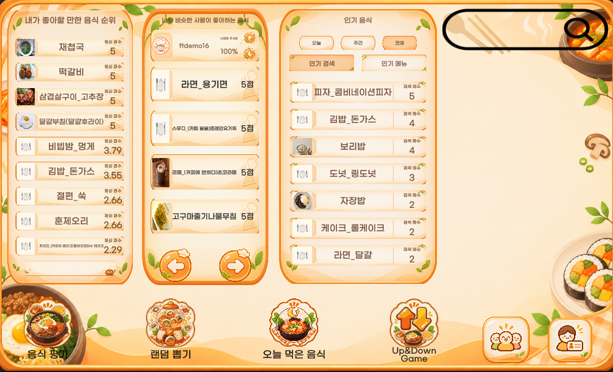
</p>
<p align="center"><strong>메인 화면 — 취향 기반 추천과 인기 음식</strong></p>

| 로그인 | 회원가입 |
|:---:|:---:|
| 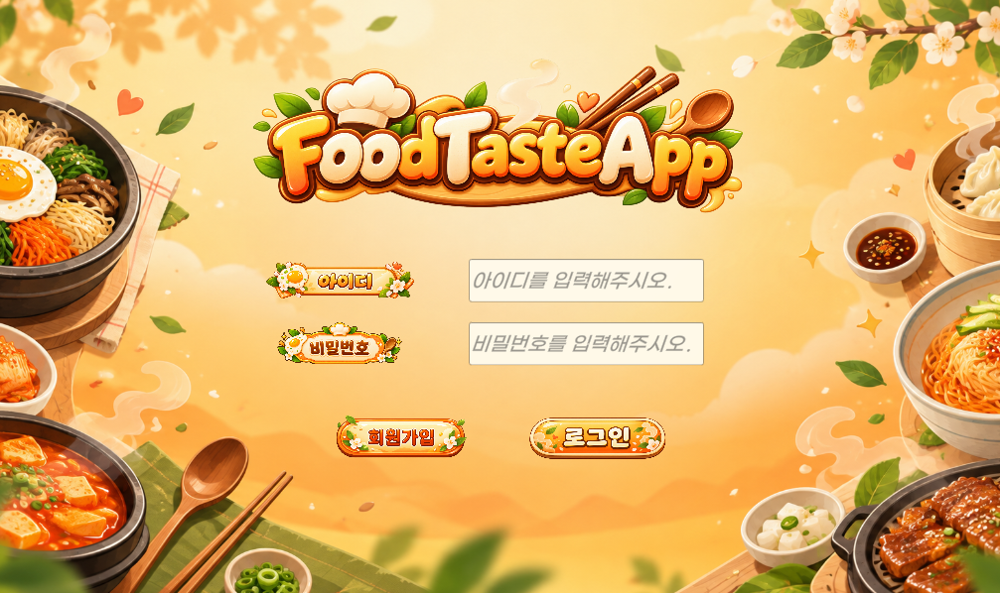 | 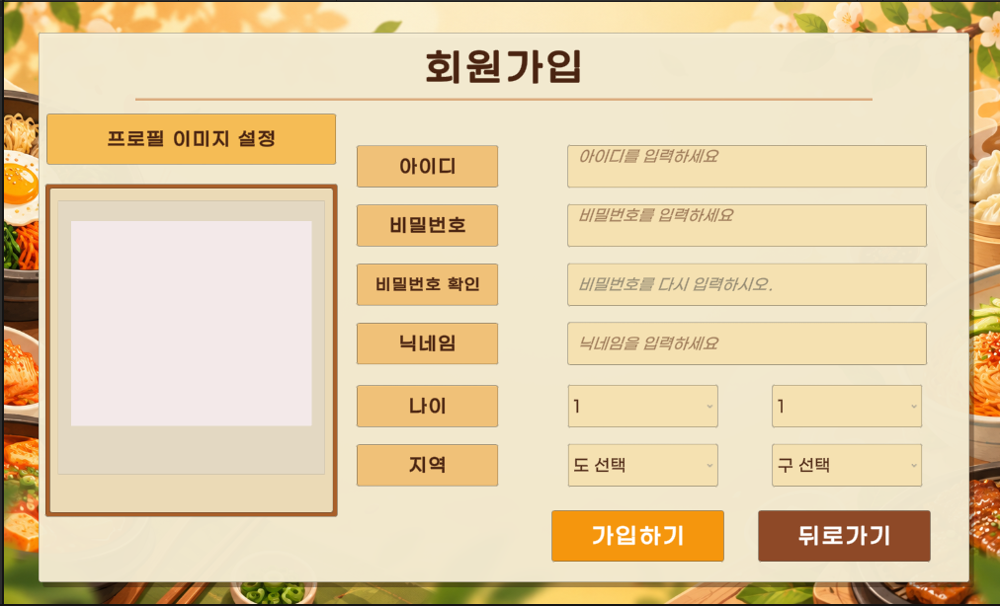 |

| 음식 상세와 댓글 | 음식 평가 |
|:---:|:---:|
| 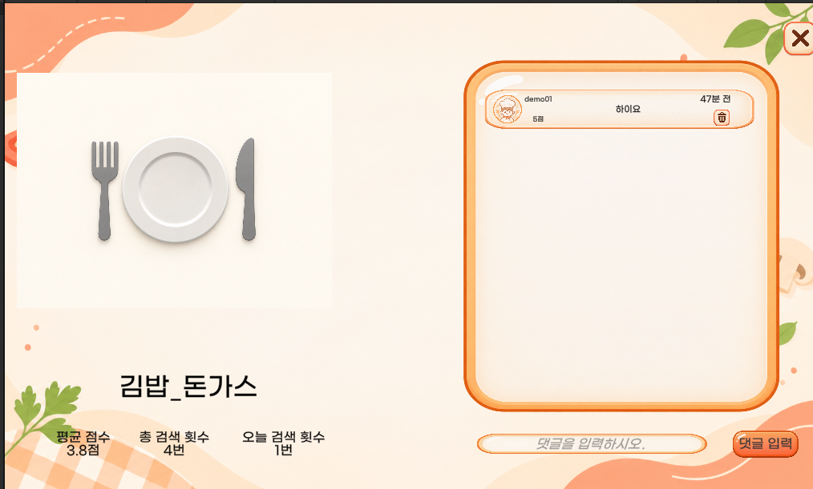 | 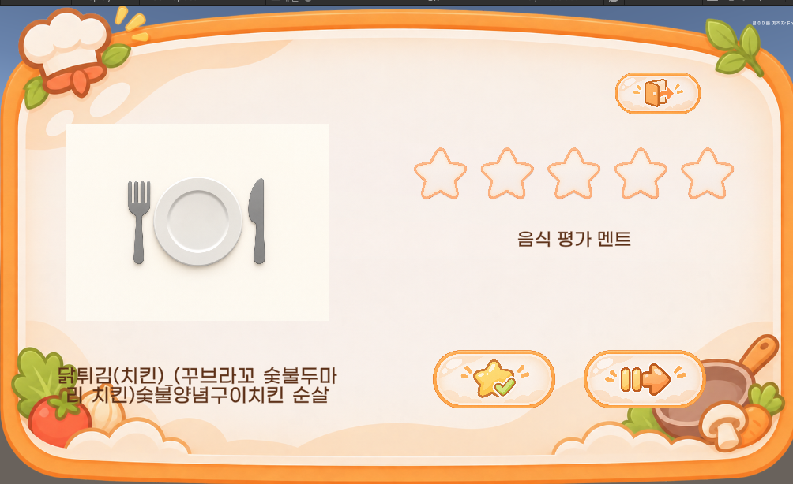 |

| 랜덤 메뉴 뽑기 | 먹은 음식 기록 |
|:---:|:---:|
| 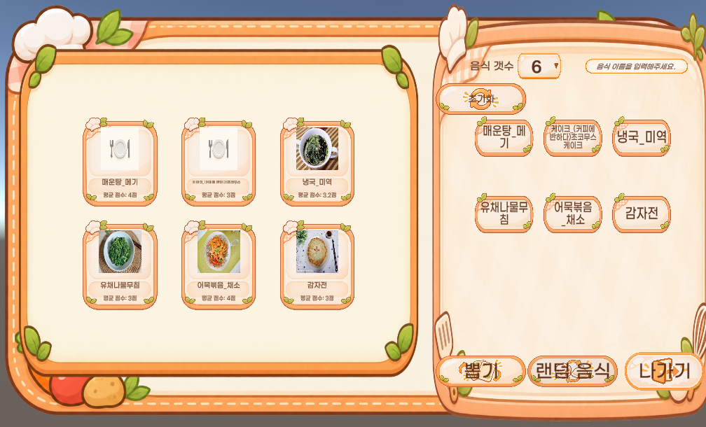 | 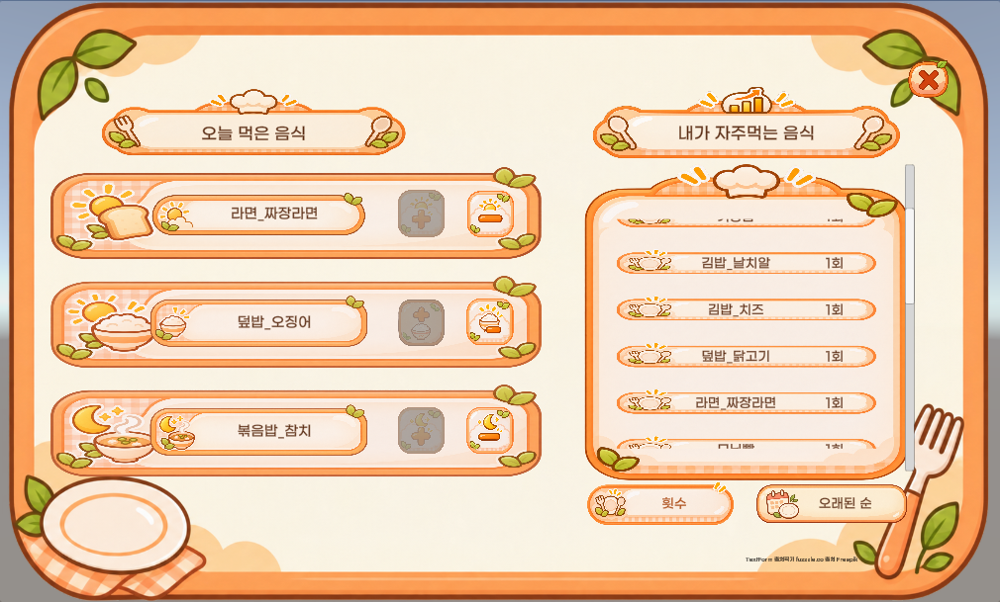 |

| 업다운 게임 | 내 정보와 평가 목록 |
|:---:|:---:|
| 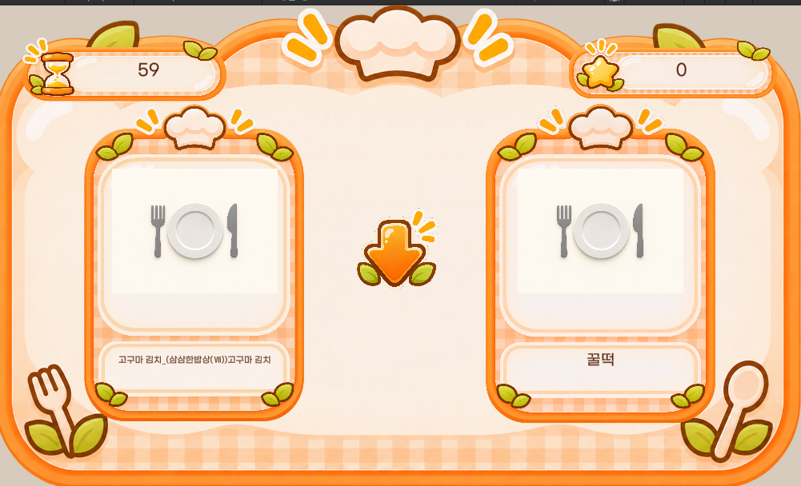 | 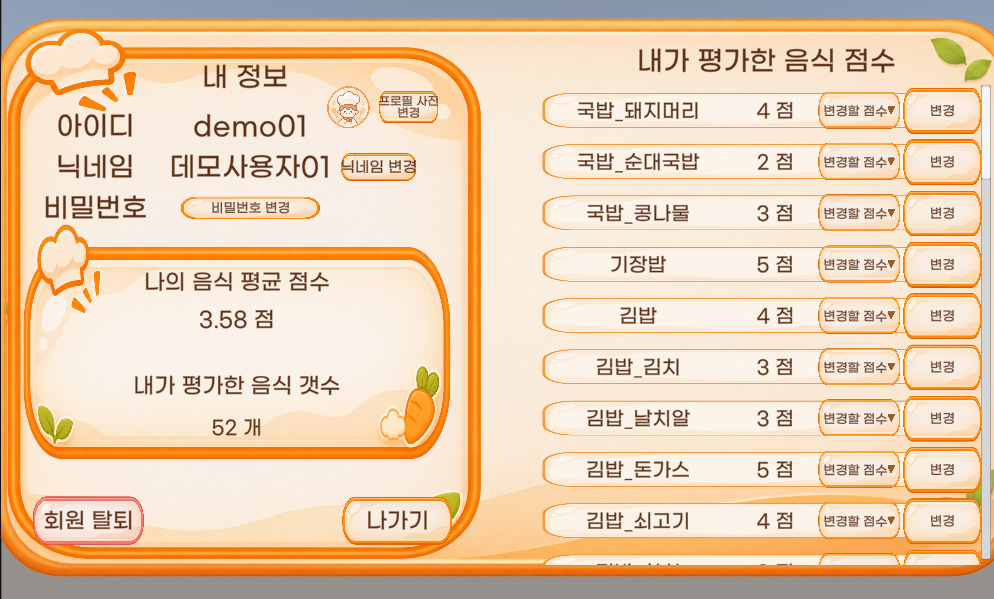 |

| 음식 검색 | 친구 채팅 |
|:---:|:---:|
| 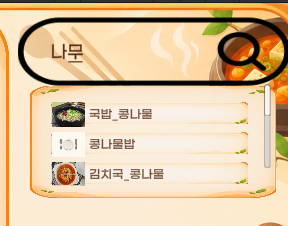 | 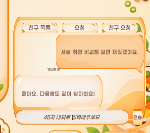 |

위 이미지는 사용자가 제공한 앱 실행 화면입니다. 데모 계정과 가상 데이터를 사용했으며, 접시 이미지는 음식 사진을 찾지 못했을 때 표시되는 대체 이미지입니다. 음식 검색과 채팅은 해당 영역을 확대한 캡처입니다.

## 2. 기획 배경

오늘 무엇을 먹을지 고르기 어렵거나, 먹어본 음식에 대한 생각을 나중에 다시 확인하기 어려운 상황에서 출발했습니다. 음식에 점수를 남기고 비슷한 취향의 평가를 참고하며, 선택이 어려울 때는 후보를 카드로 모아 고를 수 있도록 구성했습니다.

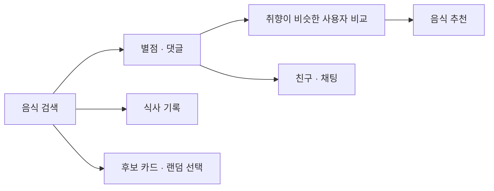

## 3. 주요 기능

| 기능 | 사용자 경험 | 관련 코드 |
|---|---|---|
| **음식 검색과 상세** | 음식 이름을 검색하고 평균 점수·검색 횟수·댓글을 확인 | [검색](Assets/Scripts/MainFuncScripts/SearchingFunc.cs) · [상세·댓글](Assets/Scripts/MainFuncScripts/For_Search_history.cs) |
| **음식 평가** | 음식에 1~5점의 별점을 남기고 내 평가 목록을 확인 | [음식 평가](Assets/Scripts/MainFuncScripts/FoodEvaManager.cs) · [내 정보](Assets/Scripts/MainFuncScripts/MyInfoPanelManager.cs) |
| **취향 기반 추천** | 공통 평가가 있는 사용자의 유사도를 비교해 추천 음식 표시 | [추천 로직](Assets/Scripts/MainFuncScripts/GetSimFoodScore.cs) |
| **먹은 음식 기록** | 아침·점심·저녁 식사와 이전에 먹은 음식 확인 | [식사 기록](Assets/Scripts/MainFuncScripts/EatCheckPanelFunc.cs) |
| **친구와 채팅** | 친구 요청·목록을 확인하고 친구와 메시지 주고받기 | [친구·채팅](Assets/Scripts/MainFuncScripts/FriendshipFunc.cs) |
| **음식 카드 선택** | 후보 음식을 카드로 만들고 섞어 메뉴 선택 | [후보 구성](Assets/Scripts/RoultteFunc/CardPickSearch.cs) · [카드 섞기](Assets/Scripts/RoultteFunc/CardMoveFunc.cs) |
| **업다운 게임** | 음식들의 평균 점수를 비교하고 최고 기록·순위 확인 | [게임 진행](Assets/Scripts/Up&DownSceneScript/GamePlayFunc.cs) · [순위](Assets/Scripts/Up&DownSceneScript/GameBackGroundFunc.cs) |

## 4. 구현 방식

### 취향에 맞는 음식 찾기

음식별 사용자 평점을 MySQL에서 가져와 사용자별 평가 목록으로 구성합니다. 두 사용자가 공통으로 평가한 음식에 대해 각자의 평균 평점을 뺀 값을 사용해 코사인 유사도를 계산하고, 비슷한 사용자의 평점을 이용해 추천 후보를 정렬합니다. 추천 화면 진입에는 **본인 평가 10개 이상**과 **공통 평가가 2개 이상인 다른 사용자 2명 이상**이 필요합니다.

이 기능은 현재 코드에 구현된 사용자 기반 추천 방식입니다. 추천 정확도를 별도 실험으로 검증한 결과는 아직 없습니다. [추천 구현 보기](Assets/Scripts/MainFuncScripts/GetSimFoodScore.cs)

### 화면과 데이터 연결

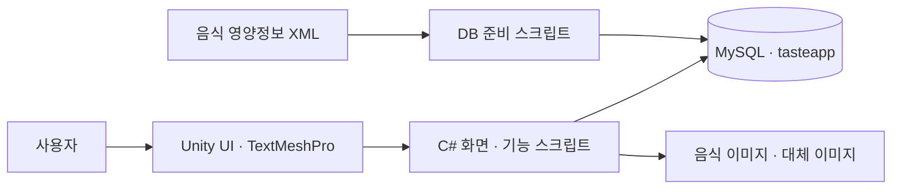

- **Unity / C#:** 검색, 평가, 친구, 식사 기록과 미니게임의 UI 및 이벤트를 처리합니다.
- **MySQL:** 음식, 사용자 평가·댓글, 식사·검색 이력, 친구 관계와 메시지를 저장합니다.
- **음식 이미지:** 음식 번호와 이름을 확인해 사진을 연결하고, 확인할 수 없는 이미지는 기본 이미지로 대체합니다. [매핑 설명](FOOD_IMAGE_MAPPING.md)
- **데모 데이터:** 별도의 스크립트로 가상 사용자·평가·댓글·친구·채팅을 로컬 DB에 채울 수 있습니다. 실제 사용자 데이터가 아닙니다.

## 5. 실행 방법

**필요 환경:** Windows, Unity **2022.3.62f3**, 로컬 MySQL Server와 `mysql` 클라이언트, Python 3. DB에 접근하는 기능은 로컬 `tasteapp` DB와 MySQL `root` 계정을 사용합니다.

1. 저장소를 내려받고 MySQL 서버를 실행합니다.
2. 프로젝트 루트의 `Install-FoodTasteDB.cmd`를 실행해 스키마, 음식 데이터, 기본 데모 사용자를 준비합니다. 비밀번호는 환경 변수 `FOODTASTE_DB_PASSWORD`로 전달하거나 설치 과정에서 입력합니다.
3. 전체 음식의 평가·댓글과 친구·채팅 데모를 추가하려면 다음 명령을 실행합니다.

   ```powershell
   py -3 .\tools\db\seed_full_demo.py
   ```

4. Unity Hub를 시작하기 전에 같은 MySQL 비밀번호를 환경 변수 `FOODTASTE_DB_PASSWORD`에 설정합니다. Unity Hub나 에디터가 이미 열려 있었다면 환경 변수를 읽도록 다시 시작합니다.
5. Unity에서 [IntroScene](Assets/Scenes/IntroScene.unity)을 열고 Play를 누릅니다. 데모 계정은 **`demo01` / `demo1234`**입니다.

테이블 구성, 환경 변수 설정과 추가 데모 계정은 [DB 설정 문서](DATABASE_SETUP.md)를 참고하세요. 이 구성은 로컬 개발·시연용이며, 운영 서비스에 바로 배포하기 위한 보안 구조는 아닙니다.

## 6. 프로젝트 구성

| 경로 | 내용 |
|---|---|
| [Assets/Scenes](Assets/Scenes) | 로그인, 메인 기능, 룰렛, 업다운 게임 씬 |
| [Assets/Scripts](Assets/Scripts) | UI 이벤트, 검색·추천·DB 연동, 게임 로직 |
| [Assets/Resources](Assets/Resources) | UI 에셋, 프리팹, 음식 데이터와 이미지 매핑 |
| [tools/db](tools/db) | MySQL 스키마 및 가상 데모 데이터 생성 도구 |
| [DATABASE_SETUP.md](DATABASE_SETUP.md) | DB 준비 및 데모 실행 안내 |

## 7. 현재 범위와 확인이 필요한 부분

- 일부 음식 사진은 제공되지 않거나 매핑 검토가 필요해 기본 이미지가 표시됩니다. [음식 이미지 설명](FOOD_IMAGE_MAPPING.md)
- 화면 이미지는 데모 실행 캡처이며 모든 해상도와 기능에 대한 검증을 의미하지 않습니다.
- 로컬 DB에 직접 연결하는 시연용 구조입니다. 계정 인증, 사용자 데이터 보호, 배포용 서버 분리는 별도 개선이 필요합니다.
- 실제 사용자를 대상으로 한 추천 성능·사용성 검증이나 운영 서비스 도입 결과는 포함하지 않았습니다.
